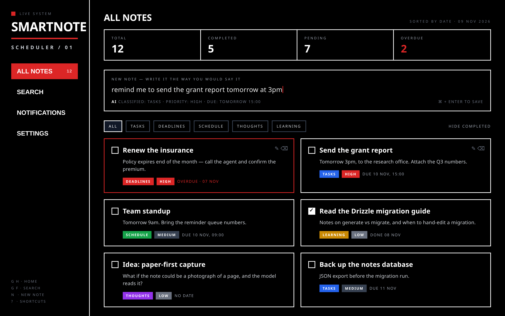
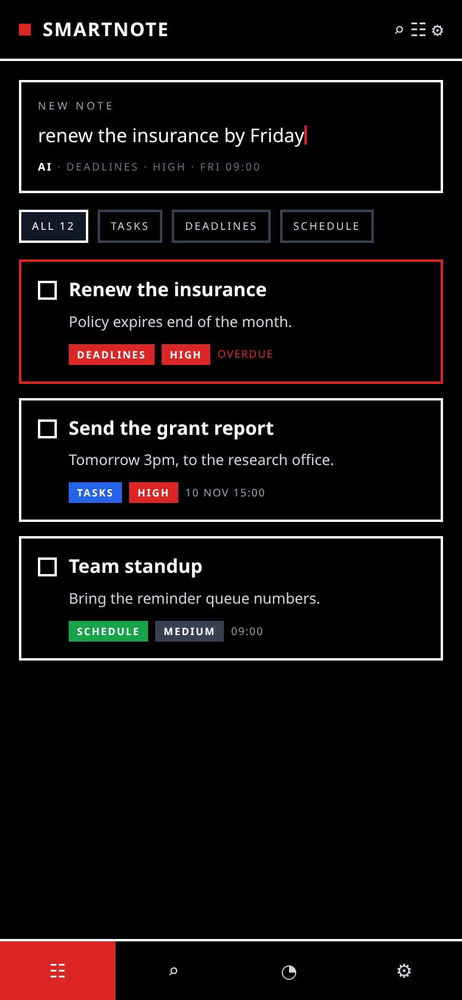
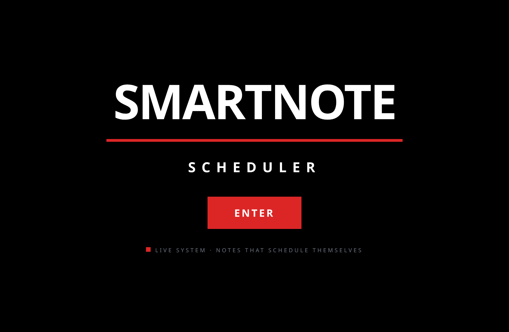

<div align="center">

# SMARTNOTE — SCHEDULER

**Notes that schedule themselves.** Write a note in plain English; it is classified,
prioritised, dated and reminded. No folders, no date pickers, no category dropdowns.

[](LICENSE)
[](#status)
[](#why-there-is-no-hosted-demo)
[](#run-it-locally)

[](package.json)
[](vite.config.ts)
[](client/src/lib/trpc.ts)
[](drizzle/schema.ts)
[](tsconfig.json)
[](drizzle.config.ts)

**[Project page](https://drsamonline.github.io/smartnote-scheduler/)** · [Run it](#run-it-locally) · [Status](#status)



</div>

---

## What it does

| | |
|---|---|
| **Five categories, assigned for you** | Tasks, Deadlines, Schedule, Thoughts and Learning — chosen by the model, not by you. |
| **Priority and dates from plain language** | Low / Medium / High, plus the date and time the note contains. |
| **Reminders that survive a restart** | Due reminders are processed by a heartbeat endpoint, not an in-process timer. |
| **Delivery you can audit** | Every push and email attempt is logged as `sent`, `failed` or `skipped`. A failure is visible, never silent. |
| **Search, filters, stats** | Full-text search, category tabs, hide-completed, and totals for pending and overdue. |
| **Your notes stay portable** | JSON backup and restore, plus CSV and Markdown export. |

## How it works

1. **Write it plainly** — one box: *“renew the insurance by Friday”*, *“standup tomorrow at 9am”*.
2. **It reads and files it** — one pass: category, priority, a title, and the date and time it found in your words.
3. **You get reminded** — the reminder is stored with the note and delivered by push, or by email when a webhook is configured.

<div align="center">

&nbsp;

</div>

> These images are **renders of the app's own layout**, produced from its components and design tokens
> (`client/src/index.css`, `BrutalistDashboard.tsx`, `NoteCard.tsx`) — not live captures. There is no hosted
> instance to capture, and a mock passed off as a screenshot would be a worse lie than saying so.

## Stack

React + Vite on the client · tRPC between client and server · Drizzle ORM with SQL migrations
(`drizzle/`) on a MySQL-compatible database · TypeScript on both sides · vitest.

## Run it locally

Node 20+, `pnpm`, and a MySQL-compatible database.

```bash
git clone https://github.com/drsamonline/smartnote-scheduler.git
cd smartnote-scheduler
pnpm install

# .env: DATABASE_URL, JWT_SECRET, and the model/webhook keys you use
pnpm db:push                  # generate + apply the migrations
pnpm dev                      # server + Vite HMR

pnpm test                     # vitest
pnpm check                    # tsc --noEmit
pnpm build && pnpm start      # production
```

Configuration is read from environment variables at start-up (`server/_core/env.ts`).
No key is stored in this repository, and `.env` is ignored.

## Why there is no hosted demo

Because it would misrepresent the software. The client is built by Vite, but every note, reminder and
login lives behind a tRPC server and a MySQL database. A static page cannot be that app — so the
[project page](https://drsamonline.github.io/smartnote-scheduler/) describes it, and you run the real
thing locally.

## Layout

```
client/     React app (Vite). client/index.html is the dev entry, not a published page.
server/     tRPC routers, reminder processing, storage, tests.
drizzle/    schema and SQL migrations.
docs/       the project page published at the URL above.
shared/     types shared by both sides.
```

## Status

**In development.** The repository is public so the work is visible while it is still being built:
there is no release, no hosted instance, and no stable API. Expect rough edges.

<!-- support:sweep -->
## Support

One person's work: no company, no ads, no tracking, no paid tier. If it saved you an
afternoon, a contribution keeps the next one coming — any amount, or none.

| | |
|---|---|
| **UPI** | `drsohilboi@ybl` |
| **Ko-fi** | [ko-fi.com/matneo](https://ko-fi.com/matneo) |
| **PayPal** | [paypal.me/drsohilmomin](https://paypal.me/drsohilmomin?locale.x=en_GB&country.x=IN) |
| **Books** | [the author's other work](https://www.amazon.com/stores/author/B08ZT331LY/allbooks) |
| **Elsewhere** | [all projects](https://drsamonline.github.io/) |
| **Email** | [sohilmomin2000@gmail.com](mailto:sohilmomin2000@gmail.com) — bugs, corrections, requests |

## Licence

MIT — see [LICENSE](LICENSE).

Author: **Dr Sohil Momin**.
